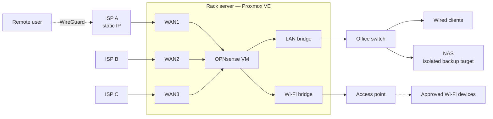

# SMB Network Architecture

**Multi-WAN, VPN and Wi-Fi access control for a small business, built on hardware it already owned.**

[🇹🇷 Türkçe](README.tr.md)

---

This repository documents the redesign of a real small-office network with three internet lines from a consumer-grade load-balance router to a virtualized **OPNsense** firewall on **Proxmox VE**. It covers the design, the decisions behind it and the step-by-step work, including hardening an end-of-life NAS.

All addresses, names and identifiers are anonymized. The project is still in progress; see the [roadmap](#roadmap).

## The problem

| Need | Why the existing setup couldn't do it |
|---|---|
| Route each network over a chosen internet line (3 lines) | The router has a single flat LAN; WAN selection only by source IP range |
| Remote access over VPN | No VPN server on the router |
| Stop Wi-Fi password sharing | The router can't tell wired from wireless clients; ISP modems broadcast their own uncontrolled Wi-Fi |
| Keep backups safe | The only NAS ran firmware with known critical remote-code-execution vulnerabilities |
| **Constraint:** no budget for new network gear | |

## The solution at a glance

- **Proxmox VE** on an existing HPE ProLiant DL360 Gen9 hosts **OPNsense** as the edge router.
- **Three WANs** in gateway groups: the office LAN and Wi-Fi each have their own primary line and failover order.
- **Wi-Fi on a dedicated physical port**, so the firewall knows every wireless client. Access is limited to an allow-list of known devices, with vouchers for guests.
- **WireGuard** for remote access on the static-IP line.
- An **end-of-life NAS** patched, wiped, hardened and isolated as the backup target.

## Documentation

| | |
|---|---|
| 1. [Context and requirements](docs/en/01-context-and-requirements.md) | Starting point, constraints, assessment of existing gear |
| 2. [Architecture](docs/en/02-architecture.md) | Topology, port plan, addressing, routing, firewall policy |
| 3. [Wi-Fi access control](docs/en/03-wifi-access-control.md) | Allow-listing without managed access points |
| 4. [Remote access and backups](docs/en/04-remote-access-and-backups.md) | WireGuard, backup flow, 3-2-1 |
| [Architecture Decision Records](docs/en/adr/README.md) | Why Proxmox, why OPNsense, why not Windows Server, … |
| [Case study: hardening an end-of-life NAS](docs/en/case-studies/eol-nas-hardening.md) | Firmware CVEs, findings, remediation |
| [Runbook: fallback to the legacy router](docs/en/runbooks/fallback-to-legacy-router.md) | Restore internet in 10 minutes if the server fails |
| [Changelog](CHANGELOG.md) | What changed, when |

## Roadmap

| Phase | Scope | Status |
|---|---|---|
| 0 | Assess existing router, access point and NAS | ✅ Done |
| 1 | NAS firmware update, wipe and hardening | ✅ Done |
| 2 | Server: firmware, RAID, Proxmox VE | ⏳ Next |
| 3 | OPNsense: WAN1 + WAN2, LAN, gateway group, cut-over | ⬜ |
| 4 | Wi-Fi segment: allow-list, captive portal, LAN isolation | ⬜ |
| 5 | WireGuard remote access | ⬜ |
| 6 | Additional NIC and third WAN | ⬜ |
| 7 | Automated VM backups to NAS + off-site copy | ⬜ |

## Tech stack

`Proxmox VE` · `OPNsense` · `WireGuard` · `HPE ProLiant DL360 Gen9 / iLO 4` · `Zyxel NAS542` · `SMB/CIFS` · `Mermaid`

## About

Designed and implemented by **Batuhan Kahraman**, IT Manager. [LinkedIn](https://www.linkedin.com/in/batuhan-kahraman-39725b2a2)

The documentation is licensed under [CC BY 4.0](LICENSE).
