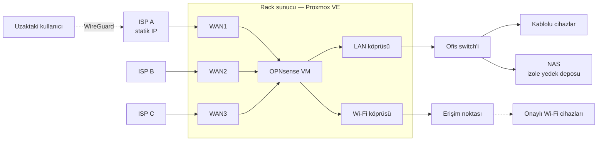

# KOBİ Ağ Mimarisi

**Küçük bir işletme için çoklu WAN, VPN ve Wi-Fi erişim kontrolü; hepsi zaten elde olan donanımla.**

[🇬🇧 English](README.md)

---

Bu repo, üç internet hattı olan gerçek bir küçük ofis ağının yeniden tasarımını anlatıyor: ev/KOBİ tipi bir yük dengeleme router'ından, **Proxmox VE** üzerinde sanal olarak çalışan bir **OPNsense** firewall'a geçiş. Tasarım, kararların gerekçeleri ve desteği bitmiş bir NAS'ın sertleştirilmesi dahil adım adım yapılan işler burada.

Tüm adresler, isimler ve tanımlayıcılar anonimleştirilmiştir. Proje devam ediyor; [yol haritasına](#yol-haritası) bakın.

## Sorun

| İhtiyaç | Mevcut yapı neden karşılayamadı |
|---|---|
| Her ağı seçilen bir hattan çıkarmak (3 hat) | Router'da tek düz LAN var. WAN seçimi yalnızca kaynak IP aralığına göre yapılabiliyor |
| VPN ile uzaktan erişim | Router'da VPN sunucusu yok |
| Wi-Fi şifre paylaşımını durdurmak | Router kablolu ve kablosuz istemciyi ayırt edemiyor. ISP modemleri kendi kontrolsüz Wi-Fi'larını yayınlıyor |
| Yedekleri güvende tutmak | Tek NAS, bilinen kritik uzaktan komut çalıştırma açıkları olan bir firmware ile çalışıyordu |
| **Kısıt:** yeni ağ ekipmanına bütçe yok | |

## Çözüme kısa bakış

- Elde boşta duran bir HPE ProLiant DL360 Gen9 üzerinde **Proxmox VE**, onun üzerinde router olarak **OPNsense**.
- **Üç WAN** gateway gruplarında: ofis LAN'ı ve Wi-Fi'ın kendi birincil hattı ve yedekleme sırası var.
- **Wi-Fi ayrı bir fiziksel portta**, yani firewall her kablosuz istemciyi tanıyor. Erişim yalnızca onaylı cihazlara açık, misafirler kuponla giriyor.
- Uzaktan erişim için statik IP'li hatta **WireGuard**.
- **Desteği bitmiş NAS** güncellendi, temizlendi, sertleştirildi ve izole yedek deposu olarak kullanılıyor.

## Dokümantasyon

| | |
|---|---|
| 1. [Bağlam ve gereksinimler](docs/tr/01-baglam-ve-gereksinimler.md) | Başlangıç noktası, kısıtlar, mevcut cihazların değerlendirmesi |
| 2. [Mimari](docs/tr/02-mimari.md) | Topoloji, port planı, adresleme, yönlendirme, firewall politikası |
| 3. [Wi-Fi erişim kontrolü](docs/tr/03-wifi-erisim-kontrolu.md) | Yönetilebilir AP olmadan beyaz liste |
| 4. [Uzaktan erişim ve yedekleme](docs/tr/04-uzaktan-erisim-ve-yedekleme.md) | WireGuard, yedekleme akışı, 3-2-1 |
| [Mimari Karar Kayıtları (ADR)](docs/tr/adr/README.md) | Neden Proxmox, neden OPNsense, neden Windows Server değil… |
| [Vaka çalışması: desteği bitmiş NAS'ın sertleştirilmesi](docs/tr/case-studies/eol-nas-hardening.md) | Firmware CVE'leri, bulgular, düzeltmeler |
| [Runbook: eski router'a dönüş](docs/tr/runbooks/eski-routera-donus.md) | Sunucu çökerse interneti 10 dakikada geri getirmek |
| [Değişiklik günlüğü](CHANGELOG.md) | Ne zaman ne değişti |

## Yol haritası

| Faz | Kapsam | Durum |
|---|---|---|
| 0 | Mevcut router, erişim noktası ve NAS'ın incelenmesi | ✅ Tamam |
| 1 | NAS firmware güncellemesi, temizlik ve sertleştirme | ✅ Tamam |
| 2 | Sunucu: firmware, RAID, Proxmox VE | ⏳ Sırada |
| 3 | OPNsense: WAN1 + WAN2, LAN, gateway grubu, geçiş | ⬜ |
| 4 | Wi-Fi segmenti: beyaz liste, captive portal, LAN izolasyonu | ⬜ |
| 5 | WireGuard ile uzaktan erişim | ⬜ |
| 6 | Ek ağ kartı ve üçüncü WAN | ⬜ |
| 7 | Sanal makinelerin NAS'a otomatik yedeklenmesi + bulut kopyası | ⬜ |

## Teknolojiler

`Proxmox VE` · `OPNsense` · `WireGuard` · `HPE ProLiant DL360 Gen9 / iLO 4` · `Zyxel NAS542` · `SMB/CIFS` · `Mermaid`

## Hakkında

Tasarım ve uygulama: **Batuhan Kahraman**, Bilgi İşlem Yöneticisi. [LinkedIn](https://www.linkedin.com/in/batuhan-kahraman-39725b2a2)

Dokümantasyon [CC BY 4.0](LICENSE) lisansı ile paylaşılmaktadır.
