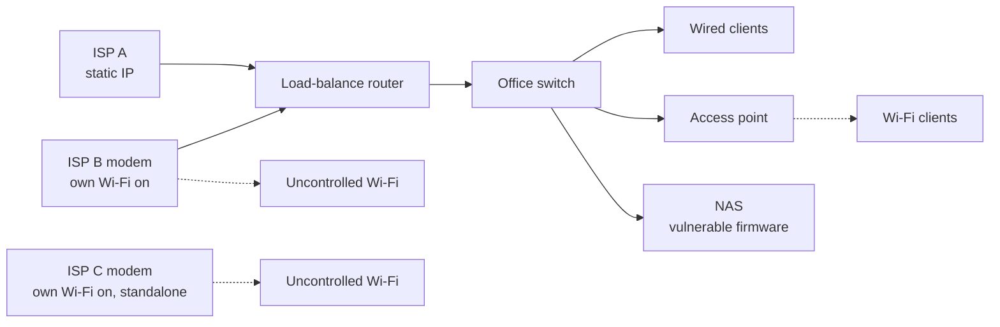
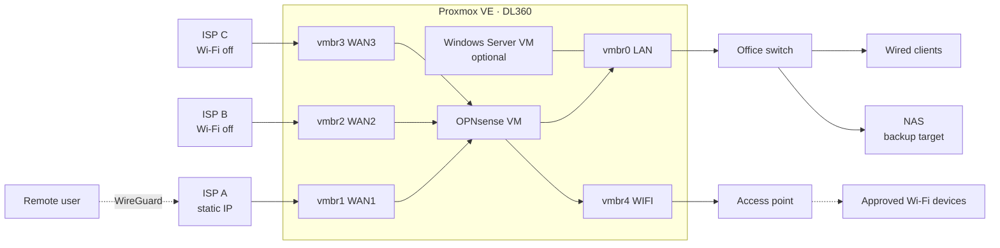

# 2. Architecture

[🇹🇷 Türkçe](../tr/02-mimari.md) · [← README](../../README.md)

## Before

One flat /24. Wi-Fi clients look the same as wired ones, two ISP Wi-Fi networks sit outside any control, and there's no VPN.

## After

## Physical port plan

No managed switch is available, so segmentation is done with **physical ports** instead of VLANs.

| Server port | Proxmox bridge | Purpose |
|---|---|---|
| Onboard 1 | vmbr1 | WAN1 (static IP) |
| Onboard 2 | vmbr2 | WAN2 |
| Onboard 3 | vmbr3 | WAN3 |
| Onboard 4 | vmbr0 | LAN (office switch) + Proxmox management |
| Add-on NIC 1 | vmbr4 | Wi-Fi (access points only) |
| Add-on NIC 2–4 | — | Reserved: guest, cameras, spare |
| iLO | — | Out-of-band management, LAN only |

The add-on NIC is a used **Intel i350-T4**, chosen for broad driver support in Proxmox and OPNsense.

> **Rule:** no access point is ever plugged into the office switch. Every wireless client therefore has to come in through the Wi-Fi interface, which is what makes the access control in [section 3](03-wifi-access-control.md) work.

Proxmox gets **no IP address on the WAN bridges**, and its web UI is reachable only from the LAN.

## Addressing (anonymized)

| Network | Subnet | Gateway | DHCP |
|---|---|---|---|
| LAN | 10.10.10.0/24 | 10.10.10.1 | Yes |
| WIFI | 10.10.20.0/24 | 10.10.20.1 | Known devices only |
| VPN | 10.10.99.0/24 | 10.10.99.1 | — |
| WAN1 | 203.0.113.2/30 | 203.0.113.1 | Static |

Keeping the LAN gateway on the same address as the old router means **no client reconfiguration** during cut-over and an easy [fallback](runbooks/fallback-to-legacy-router.md).

## Multi-WAN routing

OPNsense **gateway groups** decide per network which line is used and in what failover order:

| Group | Tier 1 | Tier 2 | Tier 3 | Used by |
|---|---|---|---|---|
| `GW_OFFICE` | WAN1 | WAN2 | WAN3 | LAN |
| `GW_WIFI` | WAN3 | WAN2 | — | WIFI |

- The office uses the static-IP line. Wi-Fi traffic goes out a separate line so guests and phones don't compete with business traffic.
- Each gateway is monitored against a **different** public IP so a single upstream outage doesn't mark every WAN as down.
- Failover is tested by unplugging WAN1 during a maintenance window.

## Firewall policy (summary)

| From | To | Action | Notes |
|---|---|---|---|
| LAN | NAS | Allow | SMB for backups and shares |
| LAN | Internet | Allow via `GW_OFFICE` | |
| WIFI | WIFI gateway (DNS, DHCP) | Allow | |
| WIFI | Private ranges (RFC 1918) | **Block** | No access to LAN or NAS |
| WIFI (allow-listed MACs) | Internet | Allow via `GW_WIFI` | |
| WIFI (others) | Internet | Captive portal | Voucher required |
| NAS | Firewall NTP | Allow | Time sync only |
| NAS | Internet | **Block** | End-of-life device, see [case study](case-studies/eol-nas-hardening.md) |
| Internet | WAN1 UDP 51820 | Allow | WireGuard |
| Internet | Anything else | Block | Default deny |

## Upstream modems

- **Wi-Fi off** on every ISP modem, otherwise those networks bypass every control above.
- **Bridge mode** where the ISP allows it, otherwise a **DMZ** entry pointing to OPNsense to avoid double-NAT problems.
- ISPs can push configuration remotely, so modem Wi-Fi is re-checked periodically.

## Virtual machines

| VM | vCPU / RAM | Autostart | Role |
|---|---|---|---|
| OPNsense | 2 / 4 GB | Order 1 | Router, firewall, VPN, captive portal |
| Windows Server 2022 | as needed | Order 2 | Optional: AD, file shares, NPS/RADIUS |

Both are backed up nightly to the NAS (see [section 4](04-remote-access-and-backups.md)).

## Known trade-offs

| Trade-off | Mitigation |
|---|---|
| The server is a single point of failure | The legacy router stays on the shelf, configured. [10-minute fallback runbook](runbooks/fallback-to-legacy-router.md) |
| Rebooting the hypervisor takes the whole office offline | Host updates only in maintenance windows. Guest (VM) updates don't affect the network |
| Higher power draw than an appliance | Accepted for now, revisit when budget allows |
| MAC-based Wi-Fi control can be spoofed | Stops casual password sharing, not a determined attacker. WPA2-Enterprise is on the long-term list |

Next: [3. Wi-Fi access control →](03-wifi-access-control.md)
