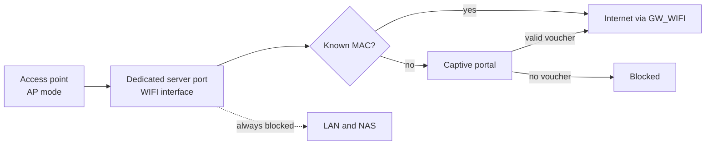

# 3. Wi-Fi Access Control Without Managed Access Points

[🇹🇷 Türkçe](../tr/03-wifi-erisim-kontrolu.md) · [← README](../../README.md)

## Goal

Learning the Wi-Fi password should **not** be enough to get online. Only approved devices, plus guests with a time-limited voucher, should reach the internet. The budget rules out managed access points (Omada, UniFi), so this has to work with a consumer access point.

## Why the obvious approaches fail

| Approach | Problem |
|---|---|
| MAC allow-list on the old router | The router can't tell wired from wireless clients, so the list applies to the whole LAN |
| MAC allow-list on the access point | Works, but there's no visibility and it's tedious to manage. It does nothing about the ISP modems' own Wi-Fi |
| Identify Wi-Fi clients by the AP's MAC address | In AP (bridge) mode, clients appear with **their own** MACs, not the AP's |
| Put the AP in router (NAT) mode | Every client hides behind one MAC, so per-device control is lost |

**Key insight:** a firewall can only control Wi-Fi clients it can *identify* as Wi-Fi clients. Without VLAN-capable access points, the most reliable way to do that is **physical**.

## Design

1. **Dedicated segment.** Access points connect *only* to the Wi-Fi port, so every client on that interface is wireless by definition.
2. **DHCP for known clients only.** The WIFI DHCP server is set to deny unknown clients, so only devices with a static mapping get an address.
3. **Firewall allow-list.** An alias of approved MAC addresses is the only source allowed out. Setting a static IP by hand doesn't help an unknown device.
4. **Captive portal with vouchers** for guests. Time-limited codes are generated in OPNsense.
5. **No lateral movement.** The WIFI segment can't reach the LAN or the NAS.

## Side benefit: rogue DHCP is contained

The access point sometimes started its own DHCP server after the upstream router rebooted, which disrupted the whole office. On its own segment, the worst it can do is affect Wi-Fi clients.

## Onboarding a device

1. On the device, turn off **private / randomized MAC address** for this network.
2. Connect it and read its MAC from the DHCP log or the captive portal session.
3. Add the MAC to the allow-list alias and to the DHCP static mappings, with a description (owner + device).
4. Record the change in the changelog.

> Planned: automate this through the OPNsense REST API (script or n8n workflow).

## Prerequisites that are easy to miss

- **Every ISP modem's Wi-Fi must be off.** Otherwise people simply move to that network.
- **No access point may remain on the office switch.**
- Do a walk-around Wi-Fi scan after deployment, and repeat it periodically.

## Limitations, honestly

- MAC addresses can be spoofed. This stops casual password sharing, not a determined attacker.
- The proper long-term answer is per-user authentication: **WPA2/3-Enterprise with RADIUS** (FreeRADIUS on OPNsense, or NPS on Windows Server), or PPSK. Both need access points that support them.

Next: [4. Remote access and backups →](04-remote-access-and-backups.md)
