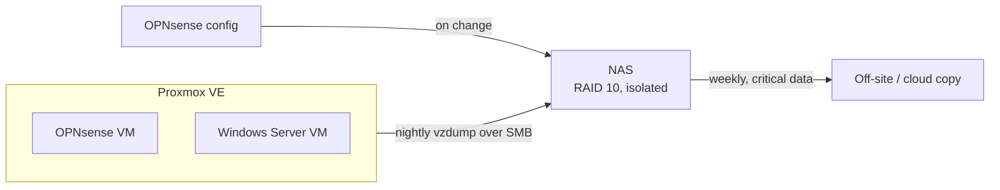

# 4. Remote Access and Backups

[🇹🇷 Türkçe](../tr/04-uzaktan-erisim-ve-yedekleme.md) · [← README](../../README.md)

## Remote access: WireGuard

| | |
|---|---|
| Endpoint | WAN1 (the static-IP line), UDP 51820 |
| Tunnel network | 10.10.99.0/24 |
| Allowed into | LAN 10.10.10.0/24 |
| Peers | One per user/device, individually revocable |
| Keys | Stored in the password manager, never in a repository |

**Why WireGuard:** it's built into OPNsense, easy to configure, has clients for every platform and makes a small, auditable attack surface.

**Management interfaces are never exposed to the internet.** That includes Proxmox (8006), OPNsense GUI, iLO and the NAS. They're reachable from the LAN or through the VPN only.

## Backups

| What | Where | When | Retention |
|---|---|---|---|
| VM backups (vzdump, compressed) | NAS, dedicated SMB share | Nightly | 7 daily + 4 weekly |
| OPNsense configuration export | NAS | After every change | Last 20 |
| Legacy router configuration | NAS | Once, before cut-over | Kept |
| Critical data | Off-site / cloud | Weekly | Per policy |

### The NAS as a backup target

- A **dedicated, non-admin user** that has access to the backup share only.
- The share is **hidden** from network browsing and not published to media or web services.
- The NAS has **no internet access**. Only NTP to the firewall is allowed.
- RAID 10 protects against a disk failure, **not** against ransomware, fire or theft. That's why the off-site copy exists.

### 3-2-1

| Rule | Status |
|---|---|
| 3 copies | Production + NAS + off-site |
| 2 different media | Server disks + NAS disks |
| 1 off-site | Cloud copy of critical data (planned) |

### Restore testing

A backup that has never been restored is a hope, not a backup. Plan: restore the OPNsense VM to a test VM ID every quarter and confirm it boots with the correct configuration.

← [3. Wi-Fi access control](03-wifi-access-control.md) · [Architecture Decision Records →](adr/README.md)
