# Case Study: Cutting an Office Over to OPNsense During Working Hours

[🇹🇷 Türkçe](../../tr/case-studies/opnsense-gecisi.md) · [← README](../../../README.md)

**Date:** 2026-10-13 → 10-15 · **Office downtime:** a few minutes · **Rollback path:** kept ready the whole time

## Approach: build next to production, then move one thing at a time

The old router kept serving the office while OPNsense was built beside it on the same LAN. Every step was chosen so it could be undone in minutes.

```mermaid
flowchart LR
    A["1 · OPNsense installed<br/>LAN link down"] --> B["2 · Test IP on LAN<br/>DHCP off"]
    B --> C["3 · Internet via ISP B<br/>static-IP line not plugged"]
    C --> D["4 · Wi-Fi moved first<br/>own segment + allow-list"]
    D --> E["5 · One PC rehearsal<br/>directly on the LAN port"]
    E --> F["6 · Old router off<br/>OPNsense takes .1"]
    F --> G["7 · Office switch<br/>connected"]
    G --> H["8 · Static-IP line<br/>plugged in"]
```



## Details that made it safe

| Risk | What was done |
|---|---|
| The OPNsense installer brings up its LAN with a DHCP server — it would hand out wrong addresses to the whole office | The VM's LAN NIC was kept **administratively down** (`link_down=1` in Proxmox) until DHCP was confirmed off (`sockstat -4 -p 67`) |
| The setup wizard silently re-enables the LAN DHCP server | Unticked in the wizard, verified again afterwards |
| The static-IP line can only be used by one device at a time | WAN1 fully configured in advance, cable left unplugged until the old router was off |
| Two DHCP servers on one LAN | The test PC was connected **directly** to the server's LAN port, with the office switch disconnected, before DHCP was enabled |
| Every device has the old gateway address hard-coded or leased | OPNsense took over **the same gateway address** (`10.10.10.1`), so no client needed reconfiguration — most kept working on their old leases |
| Reservations | Exported from the old router and imported into OPNsense via CSV before the cut-over |

## Things that went wrong (and are worth knowing)

1. **Default route stuck on a dead gateway.** With WAN1 unplugged, the default route stayed on it even though WAN2 was healthy. Fix: *allow default gateway switching* plus marking WAN1 down during the test phase.
2. **Monitor IP = DNS server.** WAN1 was monitored against `8.8.8.8`, which was also the first DNS server. Gateway monitoring adds a host route for the monitor IP through that WAN — so while WAN1 was down, DNS to `8.8.8.8` went into a dead link. Fix: monitor IPs that are **not** used as DNS (`9.9.9.9`, `1.1.1.1`).
3. **Test cable in the wrong port.** The PC ended up in the WAN1 port. Found in seconds from the hypervisor's kernel log (`nic0: Link is up`) — port-to-NIC mapping had been verified earlier with `ethtool -p` (blinks the port LED).
4. **A peer review caught real issues.** A read-only audit of the finished configuration found items 1 and 2 above before the cut-over.

## As built vs. the original design

| Original plan | As built | Why |
|---|---|---|
| Gateway groups per network | Default gateway switching (WAN1 priority, WAN2 failover) | One LAN for now; groups come with the Wi-Fi line selection |
| Wi-Fi on the add-on NIC | Wi-Fi on onboard port 3 | Add-on NIC not delivered yet; ISP C not connected |
| DHCP only for known Wi-Fi clients | DHCP for all, **firewall** allows only the MAC allow-list | Unknown devices are visible in the lease table, which makes approving them easy |
| All ISP modem Wi-Fi off | ISP B off; ISP C's left as is (owner's decision) | ISP C line is still standalone |

## Wi-Fi allow-list in practice

```
New device joins Wi-Fi → gets an address → cannot reach anything
Admin sees it in the DHCP lease list (hostname, vendor) → adds MAC to the alias → online in seconds
```

Firewall rules on the Wi-Fi interface (top-down, first match):

| # | Source | Destination | Action |
|---|---|---|---|
| 1 | Wi-Fi net | LAN net | Block, log |
| 2 | `WIFI_ALLOWED` (MAC alias) | any | Pass |
| 3 | Wi-Fi net | any | Block, log |

## How the work was done

The administrator worked on site; an AI assistant (Claude Code) ran on a remote server with no access to the office network. Read-only checks were delegated to a second assistant session on an office PC (browser automation), coordinated through a small shared task board. **Every change was made or explicitly approved by the administrator**; no credentials were ever typed by an assistant.

## Result

| | |
|---|---|
| Internet | ISP A (static IP) primary, ISP B automatic failover |
| Wi-Fi | Own segment, no access to LAN/NAS, approved devices only |
| Backups | Nightly VM backup to the NAS (snapshot mode, 7 daily + 4 weekly) |
| Next | Failover test in a maintenance window, WireGuard, third WAN, disk mirror |
