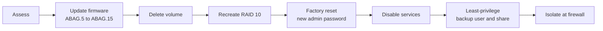

# Case Study: Hardening an End-of-Life NAS

[🇹🇷 Türkçe](../../tr/case-studies/eol-nas-hardening.md) · [← README](../../../README.md)

**Device:** Zyxel NAS542 (4-bay, 4 × 1 TB) · **Date:** 2026-10-12 · **Duration:** ~1 hour

## Summary

During the network redesign, the office NAS turned out to be running firmware with **critical, unauthenticated remote-code-execution vulnerabilities**, and its CPU was constantly at 96–100% while idle. The device was updated to the vendor's final firmware, wiped, rebuilt and locked down to a single purpose: an isolated backup target. CPU usage dropped to **11–20%**.

## Findings

| # | Finding | Severity |
|---|---|---|
| F1 | Firmware **V5.21(ABAG.5)**. The vendor's June 2024 advisory lists **ABAG.13 and earlier** as affected by CVE-2024-29972, -29973, -29974, -29975 and -29976 (command injection, RCE, privilege escalation) | 🔴 Critical |
| F2 | The product line is **end of life** (vendor EOL date: 2024-06-30). No further fixes beyond the final firmware | 🟠 High |
| F3 | CPU at **96–100%** while idle, several `python` processes at the top of the list | 🟠 High: possible compromise, can't be ruled out |
| F4 | Unneeded network services enabled by default: media server (Twonky), FTP, WebDAV | 🟡 Medium |
| F5 | Cloud sync app installed (Google Drive client) | 🟡 Medium |
| F6 | Network link negotiated at **100 Mbps** instead of 1 Gbps | 🔵 Performance |
| F7 | Desktop-class disks, one unbranded, in RAID 10 | 🔵 Reliability |

Because F3 couldn't be ruled out as a compromise, the plan was **rebuild, not repair**. The existing data was confirmed to be disposable.

## Remediation

### 1. Firmware

- The device no longer appears in the vendor's normal download library. The final image is listed on the **End-of-Life** page: `V5.21(ABAG.15)C0`.
- Uploaded manually (`.bin`, ~63.5 MB) and verified after reboot.
- The firmware went first so the rebuild would run on patched code.

### 2. Storage

- Deleted the old volume (no iSCSI LUNs were present).
- Recreated it as **RAID 10** across all four disks (1.78 TB usable). The wizard suggested RAID 5 (2.73 TB). RAID 10 was chosen because rebuilds are faster and less stressful on old desktop drives.

### 3. Configuration

- Factory reset to discard any persistence in the old configuration, then a new strong admin password, stored in a password manager.

### 4. Attack surface

| Service | Factory default | Final |
|---|---|---|
| Media server (Twonky) | On | **Off** |
| FTP | On | **Off** |
| WebDAV | On | **Off** |
| iTunes server, web publishing | Off | Off |
| Telnet, SSH | Off | Off |
| Vendor cloud agent | Not installed | Not installed |
| Google Drive client | Installed (before reset) | Removed by the reset |
| UPnP port mapping | — | No mappings, no UPnP router |
| SMB | On | On (required for backups) |

### 5. Least privilege

- User `proxmox`: standard user, **no access** to any default share.
- Share `vm-backups`: **hidden** from browsing, not published to media/web services. Read/write for the backup user and admin, guest has no access.

### 6. Network isolation (applied with the new firewall)

- NAS → internet: **blocked** (NTP to the firewall only).
- Wi-Fi segment → NAS: **blocked**.
- Management UI reachable from the LAN or VPN only.

## Results

| Metric | Before | After |
|---|---|---|
| Firmware | ABAG.5 (vulnerable) | ABAG.15 (final, patched) |
| CPU while idle | 96–100% | 11–20% |
| Enabled network services | SMB, FTP, WebDAV, media server (factory default) | SMB only |
| Backup access | — | One dedicated user, one hidden share |

## Lessons learned

1. **Inventory firmware versions.** An unpatched NAS on a flat network can become a pivot point.
2. **Abnormal resource usage on an appliance is a security signal**, not just a performance issue.
3. **When compromise can't be ruled out, rebuild.** Patching a possibly compromised system can leave an attacker's persistence in place.
4. **EOL doesn't automatically mean discard**, but it does mean *isolate, minimize and plan the replacement*.
5. **Check the physical layer.** A 100 Mbps link would have made every backup 10× slower.

## Remaining risk and follow-up

- [ ] Replace the cable / switch port to get a gigabit link
- [ ] Firewall isolation rules (with the OPNsense cut-over)
- [ ] Monthly S.M.A.R.T. checks
- [ ] Off-site copy of critical data
- [ ] Budget a supported replacement

## References

- [Zyxel security advisory for multiple vulnerabilities in NAS products (June 2024)](https://www.zyxel.com/global/en/support/security-advisories/zyxel-security-advisory-for-multiple-vulnerabilities-in-nas-products-06-04-2024)
- [Zyxel End-of-Life product list](https://www.zyxel.com/global/en/support/end-of-life)
