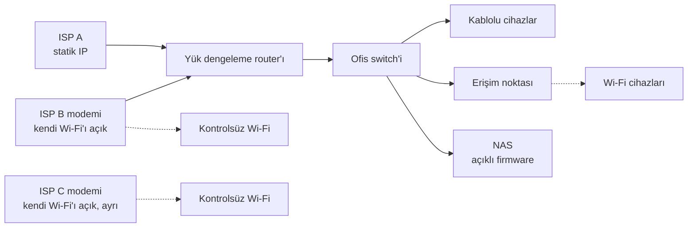
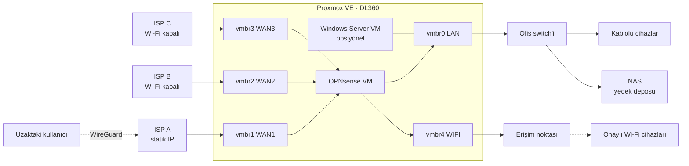

# 2. Mimari

[🇬🇧 English](../en/02-architecture.md) · [← README](../../README.tr.md)

## Önce

Tek düz bir /24 ağ. Wi-Fi istemcileri kablolularla aynı görünüyor, iki ISP Wi-Fi'ı tamamen kontrol dışında ve VPN yok.

## Sonra

## Fiziksel port planı

Yönetilebilir switch olmadığı için ağ ayrımı VLAN yerine **fiziksel portlarla** yapılıyor.

| Sunucu portu | Proxmox köprüsü | Görev |
|---|---|---|
| Dahili 1 | vmbr1 | WAN1 (statik IP) |
| Dahili 2 | vmbr2 | WAN2 |
| Dahili 3 | vmbr3 | WAN3 |
| Dahili 4 | vmbr0 | LAN (ofis switch'i) + Proxmox yönetimi |
| Ek kart 1 | vmbr4 | Wi-Fi (yalnızca erişim noktaları) |
| Ek kart 2–4 | — | Yedek: misafir, kamera, boş |
| iLO | — | Uzaktan donanım yönetimi, yalnızca LAN |

Ek kart, Proxmox ve OPNsense'teki geniş sürücü desteği nedeniyle seçilen ikinci el bir **Intel i350-T4**.

> **Kural:** hiçbir erişim noktası ofis switch'ine takılmaz. Böylece her kablosuz istemci Wi-Fi arayüzünden girmek zorunda kalır. [3. bölümdeki](03-wifi-erisim-kontrolu.md) erişim kontrolünü mümkün kılan da bu.

Proxmox'a **WAN köprülerinde IP verilmez** ve web arayüzüne yalnızca LAN'dan erişilir.

## Adresleme (anonim)

| Ağ | Alt ağ | Gateway | DHCP |
|---|---|---|---|
| LAN | 10.10.10.0/24 | 10.10.10.1 | Var |
| WIFI | 10.10.20.0/24 | 10.10.20.1 | Yalnızca bilinen cihazlar |
| VPN | 10.10.99.0/24 | 10.10.99.1 | — |
| WAN1 | 203.0.113.2/30 | 203.0.113.1 | Statik |

LAN gateway'i eski router'la aynı adreste tutulduğu için geçişte **istemcilerde hiçbir ayar değişmiyor** ve [geri dönüş](runbooks/eski-routera-donus.md) kolay oluyor.

## Çoklu WAN yönlendirme

Hangi ağın hangi hattı hangi yedekleme sırasıyla kullanacağına OPNsense'teki **gateway grupları** karar veriyor:

| Grup | 1. öncelik | 2. öncelik | 3. öncelik | Kullanan |
|---|---|---|---|---|
| `GW_OFFICE` | WAN1 | WAN2 | WAN3 | LAN |
| `GW_WIFI` | WAN3 | WAN2 | — | WIFI |

- Ofis statik IP'li hattı kullanıyor. Wi-Fi trafiği ayrı bir hattan çıkıyor, böylece misafirler ve telefonlar iş trafiğiyle yarışmıyor.
- Her gateway **farklı** bir genel IP üzerinden izleniyor. Böylece tek bir üst bağlantı kesintisi tüm WAN'ları "kapalı" göstermiyor.
- Yedekleme, bakım penceresinde WAN1 kablosu çekilerek test ediliyor.

## Firewall politikası (özet)

| Kaynak | Hedef | İşlem | Not |
|---|---|---|---|
| LAN | NAS | İzin | Yedekler ve paylaşımlar için SMB |
| LAN | İnternet | `GW_OFFICE` üzerinden izin | |
| WIFI | WIFI gateway'i (DNS, DHCP) | İzin | |
| WIFI | Özel ağlar (RFC 1918) | **Engelle** | LAN'a ve NAS'a erişim yok |
| WIFI (beyaz listedeki MAC'ler) | İnternet | `GW_WIFI` üzerinden izin | |
| WIFI (diğerleri) | İnternet | Captive portal | Kupon gerekli |
| NAS | Firewall NTP | İzin | Yalnızca saat senkronu |
| NAS | İnternet | **Engelle** | Desteği bitmiş cihaz, bkz. [vaka çalışması](case-studies/eol-nas-hardening.md) |
| İnternet | WAN1 UDP 51820 | İzin | WireGuard |
| İnternet | Diğer her şey | Engelle | Varsayılan red |

## ISP modemleri

- Her ISP modeminde **Wi-Fi kapalı**. Yoksa bu ağlar yukarıdaki tüm kontrolleri atlar.
- ISP izin veriyorsa **köprü (bridge) modu**, vermiyorsa çift NAT sorunlarından kaçınmak için OPNsense'e yönlendirilmiş bir **DMZ** kaydı.
- ISP'ler modem ayarlarını uzaktan değiştirebildiği için modem Wi-Fi'ları dönemsel olarak yeniden kontrol ediliyor.

## Sanal makineler

| VM | vCPU / RAM | Otomatik başlatma | Rol |
|---|---|---|---|
| OPNsense | 2 / 4 GB | Sıra 1 | Router, firewall, VPN, captive portal |
| Windows Server 2022 | ihtiyaca göre | Sıra 2 | Opsiyonel: AD, dosya paylaşımı, NPS/RADIUS |

İkisi de her gece NAS'a yedekleniyor (bkz. [4. bölüm](04-uzaktan-erisim-ve-yedekleme.md)).

## Bilinen ödünleşimler

| Ödünleşim | Önlem |
|---|---|
| Sunucu tek arıza noktası | Eski router ayarlarıyla birlikte rafta duruyor. [10 dakikalık geri dönüş runbook'u](runbooks/eski-routera-donus.md) |
| Hipervizörü yeniden başlatmak tüm ofisi internetsiz bırakır | Host güncellemeleri yalnızca bakım penceresinde. Sanal makine güncellemeleri ağı etkilemiyor |
| Hazır cihaza göre daha yüksek enerji tüketimi | Şimdilik kabul edildi, bütçe oluşunca tekrar değerlendirilecek |
| MAC tabanlı Wi-Fi kontrolü taklit edilebilir | Sıradan şifre paylaşımını durdurur, kararlı bir saldırganı durdurmaz. WPA2-Enterprise uzun vadeli listede |

Sonraki: [3. Wi-Fi erişim kontrolü →](03-wifi-erisim-kontrolu.md)
