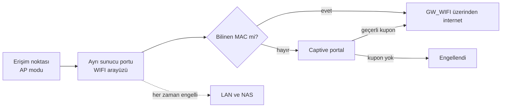

# 3. Yönetilebilir Erişim Noktası Olmadan Wi-Fi Erişim Kontrolü

[🇬🇧 English](../en/03-wifi-access-control.md) · [← README](../../README.tr.md)

## Hedef

Wi-Fi şifresini öğrenmek internete çıkmak için **yeterli olmamalı**. İnternete yalnızca onaylı cihazlar ve süreli kuponu olan misafirler çıkabilmeli. Bütçe yönetilebilir erişim noktalarına (Omada, UniFi) izin vermediği için çözümün ev tipi bir erişim noktasıyla çalışması gerekiyor.

## Akla ilk gelen yöntemler neden işe yaramıyor

| Yöntem | Sorun |
|---|---|
| Eski router'da MAC beyaz listesi | Router kablolu ve kablosuz istemciyi ayırt edemiyor, liste tüm LAN'a uygulanıyor |
| Erişim noktasında MAC beyaz listesi | Çalışıyor ama görünürlük yok ve yönetmesi zahmetli. ISP modemlerinin Wi-Fi'ına da bir etkisi yok |
| Wi-Fi istemcilerini AP'nin MAC'inden tanımak | AP (köprü) modunda istemciler AP'nin değil **kendi** MAC'leriyle görünüyor |
| AP'yi router (NAT) moduna almak | Tüm istemciler tek bir MAC'in arkasına gizleniyor, cihaz bazlı kontrol kayboluyor |

**Temel fikir:** firewall yalnızca Wi-Fi istemcisi olarak *tanıyabildiği* istemcileri kontrol edebilir. VLAN destekli erişim noktası yoksa, bunu sağlamanın en güvenilir yolu **fiziksel** ayrım.

## Tasarım

1. **Ayrı segment.** Erişim noktaları *yalnızca* Wi-Fi portuna bağlanıyor. O arayüzdeki her istemci tanım gereği kablosuz.
2. **Yalnızca bilinen istemcilere DHCP.** WIFI DHCP sunucusu bilinmeyen istemcileri reddediyor. Yalnızca statik eşlemesi olan cihazlar IP alıyor.
3. **Firewall beyaz listesi.** Dışarı çıkabilen tek kaynak, onaylı MAC adreslerinden oluşan bir alias. Bilinmeyen bir cihaz elle statik IP verse de işe yaramıyor.
4. Misafirler için **kuponlu captive portal**. Süreli kodlar OPNsense'te üretiliyor.
5. **Yatay hareket yok.** WIFI segmenti LAN'a ve NAS'a erişemiyor.

## Yan fayda: sahte DHCP sınırlanıyor

Erişim noktası, üstteki router yeniden başladıktan sonra zaman zaman kendi DHCP sunucusunu açıyor ve tüm ofisi etkiliyordu. Ayrı segmentte en fazla Wi-Fi istemcilerini etkileyebilir.

## Yeni cihaz ekleme

1. Cihazda bu ağ için **özel / rastgele MAC adresi** kapatılır.
2. Cihaz bağlanır, MAC adresi DHCP günlüğünden ya da captive portal oturumundan okunur.
3. MAC adresi açıklamasıyla (sahibi + cihaz) beyaz liste alias'ına ve DHCP statik eşlemelerine eklenir.
4. Değişiklik günlüğe yazılır.

> Planlanan: bu adımların OPNsense REST API'siyle otomatikleştirilmesi (script ya da n8n akışı).

## Kolayca gözden kaçan önkoşullar

- **Her ISP modeminin Wi-Fi'ı kapalı olmalı.** Yoksa insanlar doğrudan o ağa geçer.
- **Ofis switch'inde hiçbir erişim noktası kalmamalı.**
- Kurulumdan sonra ofiste dolaşarak Wi-Fi taraması yapılmalı ve bu düzenli tekrarlanmalı.

## Açıkça söylemek gerekirse sınırlar

- MAC adresi taklit edilebilir. Bu yöntem sıradan şifre paylaşımını durdurur, kararlı bir saldırganı durdurmaz.
- Uzun vadeli doğru çözüm kişi bazlı kimlik doğrulama: **RADIUS ile WPA2/3-Enterprise** (OPNsense'te FreeRADIUS ya da Windows Server'da NPS) veya PPSK. İkisi de bunu destekleyen erişim noktaları gerektiriyor.

Sonraki: [4. Uzaktan erişim ve yedekleme →](04-uzaktan-erisim-ve-yedekleme.md)
