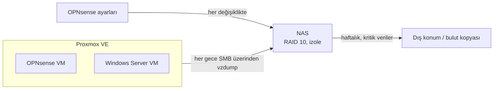

# 4. Uzaktan Erişim ve Yedekleme

[🇬🇧 English](../en/04-remote-access-and-backups.md) · [← README](../../README.tr.md)

## Uzaktan erişim: WireGuard

| | |
|---|---|
| Giriş noktası | WAN1 (statik IP'li hat), UDP 51820 |
| Tünel ağı | 10.10.99.0/24 |
| Erişilebilen ağ | LAN 10.10.10.0/24 |
| Peer'lar | Her kullanıcı/cihaz için ayrı, tek tek iptal edilebilir |
| Anahtarlar | Parola yöneticisinde, asla bir repoda değil |

**Neden WireGuard:** OPNsense'te yerleşik geliyor, yapılandırması kolay, her platform için istemcisi var ve saldırı yüzeyi küçük, denetlenebilir.

**Yönetim arayüzleri asla internete açılmaz.** Bu Proxmox (8006), OPNsense arayüzü, iLO ve NAS için geçerli. Hepsine yalnızca LAN'dan ya da VPN üzerinden erişilir.

## Yedekleme

| Ne | Nereye | Ne zaman | Saklama |
|---|---|---|---|
| VM yedekleri (vzdump, sıkıştırılmış) | NAS, ayrı SMB paylaşımı | Her gece | 7 günlük + 4 haftalık |
| OPNsense yapılandırma dışa aktarımı | NAS | Her değişiklikten sonra | Son 20 |
| Eski router yapılandırması | NAS | Bir kez, geçişten önce | Saklanır |
| Kritik veriler | Dış konum / bulut | Haftalık | Politikaya göre |

### Yedek deposu olarak NAS

- Yalnızca yedek paylaşımına erişebilen, **yönetici olmayan ayrı bir kullanıcı**.
- Paylaşım ağ taramasında **gizli**, medya ya da web servislerinde yayınlanmıyor.
- NAS'ın **internet erişimi yok**. Yalnızca firewall'a NTP izni var.
- RAID 10 disk arızasına karşı korur. Fidye yazılımına, yangına ya da hırsızlığa karşı **korumaz**. Dış konumdaki kopya bu yüzden var.

### 3-2-1

| Kural | Durum |
|---|---|
| 3 kopya | Canlı sistem + NAS + dış konum |
| 2 farklı ortam | Sunucu diskleri + NAS diskleri |
| 1 dış konum | Kritik verilerin bulut kopyası (planlandı) |

### Geri yükleme testi

Hiç geri yüklenmemiş bir yedek yedek değil, umuttur. Plan: her çeyrekte OPNsense VM'ini test amaçlı farklı bir VM numarasına geri yüklemek ve doğru yapılandırmayla açıldığını doğrulamak.

← [3. Wi-Fi erişim kontrolü](03-wifi-erisim-kontrolu.md) · [Mimari Karar Kayıtları →](adr/README.md)
