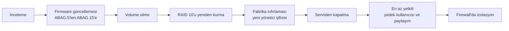

# Vaka Çalışması: Desteği Bitmiş Bir NAS'ın Sertleştirilmesi

[🇬🇧 English](../../en/case-studies/eol-nas-hardening.md) · [← README](../../../README.tr.md)

**Cihaz:** Zyxel NAS542 (4 yuva, 4 × 1 TB) · **Tarih:** 2026-10-12 · **Süre:** ~1 saat

## Özet

Ağın yeniden tasarımı sırasında ofisteki NAS'ın **kimlik doğrulama gerektirmeyen kritik uzaktan komut çalıştırma açıkları** bulunan bir firmware ile çalıştığı ve boştayken CPU'sunun sürekli %96–100'de olduğu ortaya çıktı. Cihaz üreticinin son firmware'ine güncellendi, silindi, sıfırdan kuruldu ve tek bir işe kilitlendi: izole yedek deposu. CPU kullanımı **%11–20**'ye düştü.

## Bulgular

| # | Bulgu | Önem |
|---|---|---|
| B1 | Firmware **V5.21(ABAG.5)**. Üreticinin Haziran 2024 güvenlik bildirimi **ABAG.13 ve öncesini** CVE-2024-29972, -29973, -29974, -29975 ve -29976'dan etkilenen sürümler olarak listeliyor (komut enjeksiyonu, uzaktan kod çalıştırma, yetki yükseltme) | 🔴 Kritik |
| B2 | Ürün grubu **destek ömrünü tamamlamış** (üretici EOL tarihi: 2024-06-30). Son firmware dışında düzeltme gelmeyecek | 🟠 Yüksek |
| B3 | Boştayken CPU **%96–100**, listenin en üstünde birden fazla `python` süreci | 🟠 Yüksek: ele geçirilmiş olma ihtimali dışlanamıyor |
| B4 | Varsayılan olarak açık gereksiz servisler: medya sunucusu (Twonky), FTP, WebDAV | 🟡 Orta |
| B5 | Bulut senkronizasyon uygulaması kurulu (Google Drive istemcisi) | 🟡 Orta |
| B6 | Ağ bağlantısı 1 Gbps yerine **100 Mbps**'te | 🔵 Performans |
| B7 | RAID 10'da masaüstü sınıfı diskler, biri markasız | 🔵 Güvenilirlik |

B3 ele geçirilme ihtimalini dışlamaya izin vermediği için plan **onarmak değil, sıfırdan kurmak** oldu. Mevcut verilerin gerekmediği önceden teyit edildi.

## Düzeltme

### 1. Firmware

- Cihaz artık üreticinin normal indirme kütüphanesinde görünmüyor. Son imaj **End-of-Life** sayfasında listeleniyor: `V5.21(ABAG.15)C0`.
- Elle yüklendi (`.bin`, ~63,5 MB) ve yeniden başlatma sonrası doğrulandı.
- Firmware ilk adımdı, böylece yeniden kurulum yamalı kod üzerinde yapıldı.

### 2. Depolama

- Eski volume silindi (iSCSI LUN yoktu).
- Dört diskle **RAID 10** olarak yeniden oluşturuldu (1,78 TB kullanılabilir). Sihirbaz RAID 5 (2,73 TB) öneriyordu. RAID 10 seçildi, çünkü yeniden yapılandırma daha hızlı ve eski masaüstü disklerini daha az zorluyor.

### 3. Yapılandırma

- Eski yapılandırmada kalmış olabilecek her şeyi atmak için fabrika sıfırlaması yapıldı. Ardından parola yöneticisinde saklanan yeni, güçlü bir yönetici şifresi belirlendi.

### 4. Saldırı yüzeyi

| Servis | Fabrika varsayılanı | Son durum |
|---|---|---|
| Medya sunucusu (Twonky) | Açık | **Kapalı** |
| FTP | Açık | **Kapalı** |
| WebDAV | Açık | **Kapalı** |
| iTunes sunucusu, web yayınlama | Kapalı | Kapalı |
| Telnet, SSH | Kapalı | Kapalı |
| Üretici bulut ajanı | Yüklü değil | Yüklü değil |
| Google Drive istemcisi | Yüklü (sıfırlama öncesi) | Sıfırlamayla kaldırıldı |
| UPnP port yönlendirme | — | Kural yok, ağda UPnP router yok |
| SMB | Açık | Açık (yedekleme için gerekli) |

### 5. En az yetki

- Kullanıcı `proxmox`: standart kullanıcı, varsayılan paylaşımların **hiçbirine erişimi yok**.
- Paylaşım `vm-backups`: ağ taramasında **gizli**, medya/web servislerinde yayınlanmıyor. Yedek kullanıcısı ve yöneticiye okuma/yazma, misafire erişim yok.

### 6. Ağ izolasyonu (yeni firewall ile uygulanacak)

- NAS → internet: **engelli** (yalnızca firewall'a NTP).
- Wi-Fi segmenti → NAS: **engelli**.
- Yönetim arayüzüne yalnızca LAN'dan ya da VPN üzerinden erişim.

## Sonuçlar

| Ölçüt | Önce | Sonra |
|---|---|---|
| Firmware | ABAG.5 (açıklı) | ABAG.15 (son sürüm, yamalı) |
| Boştayken CPU | %96–100 | %11–20 |
| Açık ağ servisleri | SMB, FTP, WebDAV, medya sunucusu (fabrika varsayılanı) | Yalnızca SMB |
| Yedekleme erişimi | — | Tek ayrı kullanıcı, tek gizli paylaşım |

## Çıkarılan dersler

1. **Firmware sürümlerinin envanterini tutun.** Düz bir ağdaki yamasız bir NAS, saldırgan için sıçrama noktası olabilir.
2. **Bir cihazda anormal kaynak kullanımı bir güvenlik sinyalidir**, yalnızca performans sorunu değil.
3. **Ele geçirilme ihtimali dışlanamıyorsa sıfırdan kurun.** Ele geçirilmiş olabilecek bir sistemi yamamak, saldırganın bıraktığı kalıcılığı yerinde bırakabilir.
4. **Desteği bitmiş olmak her zaman atmak demek değildir**, ama *izole etmek, küçültmek ve değiştirmeyi planlamak* demektir.
5. **Fiziksel katmanı kontrol edin.** 100 Mbps bir bağlantı her yedeği 10 kat yavaşlatırdı.

## Kalan risk ve takip

- [ ] Gigabit bağlantı için kabloyu / switch portunu değiştirmek
- [ ] Firewall izolasyon kuralları (OPNsense geçişiyle birlikte)
- [ ] Aylık S.M.A.R.T. kontrolü
- [ ] Kritik verilerin dış konumda kopyası
- [ ] Desteklenen bir cihaz için bütçe

## Kaynaklar

- [Zyxel güvenlik bildirimi: NAS ürünlerinde birden fazla açık (Haziran 2024)](https://www.zyxel.com/global/en/support/security-advisories/zyxel-security-advisory-for-multiple-vulnerabilities-in-nas-products-06-04-2024)
- [Zyxel End-of-Life ürün listesi](https://www.zyxel.com/global/en/support/end-of-life)
