# Vaka Çalışması: Ofisi Mesai Saatinde OPNsense'e Geçirmek

[🇬🇧 English](../../en/case-studies/cutover-to-opnsense.md) · [← README](../../../README.tr.md)

**Tarih:** 2026-10-13 → 10-15 · **Ofiste kesinti:** birkaç dakika · **Geri dönüş yolu:** baştan sona hazır tutuldu

## Yaklaşım: Canlı sistemin yanında kur, sonra her seferinde tek şeyi taşı

Eski router ofise hizmet vermeye devam ederken OPNsense aynı LAN üzerinde, onun yanında kuruldu. Her adım birkaç dakikada geri alınabilecek şekilde seçildi.

```mermaid
flowchart LR
    A["1 · OPNsense kuruldu<br/>LAN bağlantısı kapalı"] --> B["2 · LAN'da test IP'si<br/>DHCP kapalı"]
    B --> C["3 · İnternet ISP B'den<br/>statik IP hattı takılı değil"]
    C --> D["4 · Önce Wi-Fi taşındı<br/>ayrı segment + izin listesi"]
    D --> E["5 · Tek PC provası<br/>doğrudan LAN portunda"]
    E --> F["6 · Eski router kapatıldı<br/>OPNsense .1'i aldı"]
    F --> G["7 · Ofis switch'i<br/>bağlandı"]
    G --> H["8 · Statik IP hattı<br/>takıldı"]
```



## Geçişi güvenli kılan ayrıntılar

| Risk | Yapılan |
|---|---|
| OPNsense kurulum programı LAN'ı DHCP sunucusuyla açar ve bütün ofise yanlış adres dağıtabilir | VM'in LAN kartı, DHCP'nin kapalı olduğu doğrulanana kadar (`sockstat -4 -p 67`) **yönetsel olarak kapalı** tutuldu (Proxmox'ta `link_down=1`) |
| Kurulum sihirbazı LAN DHCP sunucusunu sessizce yeniden açıyor | Sihirbazda işareti kaldırıldı, sonra tekrar doğrulandı |
| Statik IP hattını aynı anda yalnız bir cihaz kullanabilir | WAN1 önceden tamamen yapılandırıldı, kablo eski router kapanana kadar takılmadı |
| Aynı LAN'da iki DHCP sunucusu | DHCP açılmadan önce test PC'si, ofis switch'i ayrıkken sunucunun LAN portuna **doğrudan** bağlandı |
| Bütün cihazlar eski gateway adresini biliyor (sabit ya da kiralık) | OPNsense **aynı gateway adresini** (`10.10.10.1`) devraldı; hiçbir istemcinin ayarı değişmedi, çoğu eski kirasıyla çalışmaya devam etti |
| Rezervasyonlar | Geçişten önce eski router'dan alınıp OPNsense'e CSV ile aktarıldı |

## Ters giden şeyler (bilmeye değer)

1. **Varsayılan yol ölü ağ geçidinde kaldı.** WAN1 takılı değilken varsayılan yol, WAN2 sağlıklı olduğu halde WAN1'de kaldı. Çözüm: *Varsayılan ağ geçidi değişimine izin ver* ayarı ve test aşamasında WAN1'in "down" olarak işaretlenmesi.
2. **İzleme IP'si = DNS sunucusu.** WAN1 `8.8.8.8` ile izleniyordu ve bu adres aynı zamanda 1. DNS sunucusuydu. Ağ geçidi izlemesi, izleme IP'si için o WAN üzerinden özel bir yol ekliyor; WAN1 kapalıyken `8.8.8.8`'e giden DNS sorguları da ölü hatta gitti. Çözüm: DNS olarak **kullanılmayan** izleme IP'leri (`9.9.9.9`, `1.1.1.1`).
3. **Test kablosu yanlış portta.** PC, WAN1 portuna takılmıştı. Sanallaştırma sunucusunun kernel log'undan (`nic0: Link is up`) saniyeler içinde bulundu. Port ile ağ kartı eşleşmesi daha önce `ethtool -p` (port ışığını yakıp söndürür) ile doğrulanmıştı.
4. **Bir eş denetim gerçek sorunlar buldu.** Bitmiş yapılandırmanın salt okunur denetimi, yukarıdaki 1. ve 2. maddeyi geçişten önce yakaladı.

## İlk tasarım ile kurulan sistem

| İlk plan | Kurulan | Neden |
|---|---|---|
| Ağ başına gateway grupları | Varsayılan ağ geçidi değiştirme (WAN1 öncelikli, WAN2 yedek) | Şimdilik tek LAN var; gruplar Wi-Fi hat seçimiyle gelecek |
| Wi-Fi ek ağ kartında | Wi-Fi dahili port 3'te | Ek kart henüz gelmedi; ISP C bağlı değil |
| Wi-Fi'da yalnız bilinen istemcilere DHCP | Herkese DHCP; **güvenlik duvarı** yalnız MAC izin listesine izin veriyor | Bilinmeyen cihazlar kira listesinde görünüyor, onay vermek kolaylaşıyor |
| Bütün ISP modemlerinin Wi-Fi'ı kapalı | ISP B kapalı; ISP C olduğu gibi bırakıldı (işletme kararı) | ISP C hattı hâlâ ayrı çalışıyor |

## Wi-Fi izin listesi pratikte

```
Yeni cihaz Wi-Fi'a bağlanır → adres alır → hiçbir yere ulaşamaz
Yönetici cihazı DHCP kira listesinde görür (ad, üretici) → MAC'i takma ada ekler → cihaz saniyeler içinde internete çıkar
```

Wi-Fi arayüzündeki kurallar (yukarıdan aşağı, ilk eşleşen uygulanır):

| # | Kaynak | Hedef | Eylem |
|---|---|---|---|
| 1 | Wi-Fi ağı | LAN ağı | Engelle, log |
| 2 | `WIFI_IZINLI` (MAC takma adı) | her yer | İzin ver |
| 3 | Wi-Fi ağı | her yer | Engelle, log |

## Çalışma yöntemi

Yönetici sahadaydı; bir yapay zekâ asistanı (Claude Code) ofis ağına erişimi olmayan uzak bir sunucuda çalıştı. Salt okunur kontroller, ofisteki bir PC'de çalışan ikinci bir asistan oturumuna (tarayıcı otomasyonu) verildi ve küçük, paylaşılan bir görev panosu üzerinden koordine edildi. **Her değişikliği yönetici kendisi yaptı ya da açıkça onayladı**; hiçbir şifreyi asistan girmedi.

## Sonuç

| | |
|---|---|
| İnternet | ISP A (statik IP) ana hat, ISP B'ye otomatik geçiş |
| Wi-Fi | Ayrı segment, LAN/NAS'a erişim yok, yalnız onaylı cihazlar |
| Yedekler | NAS'a gecelik VM yedeği (snapshot modu, 7 günlük + 4 haftalık) |
| Sırada | Bakım penceresinde yedek hat testi, WireGuard, üçüncü WAN, disk aynası |
